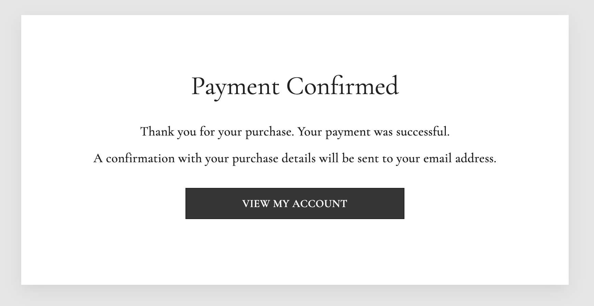
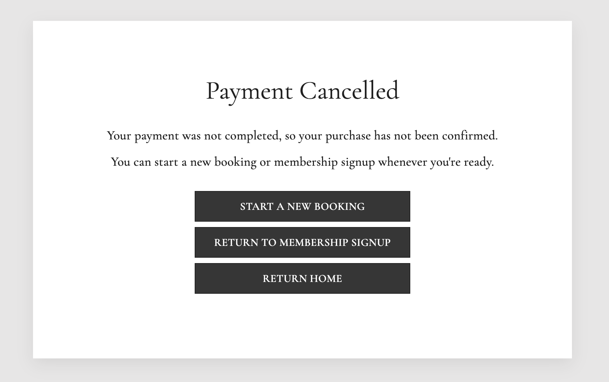
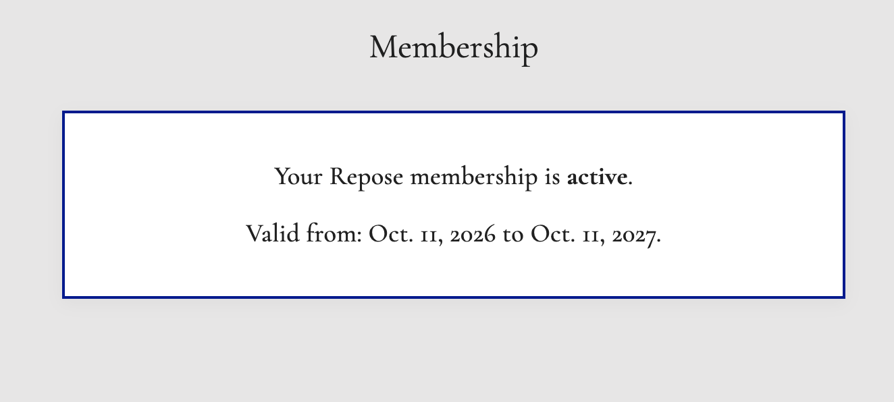
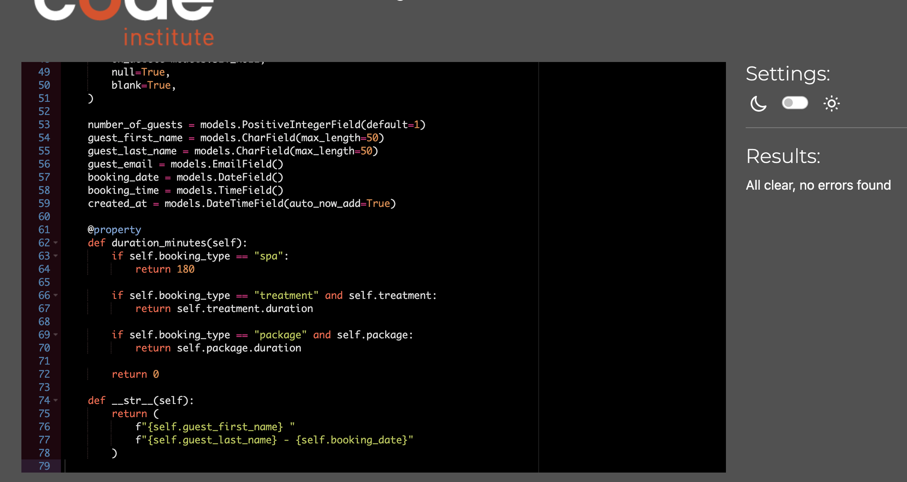
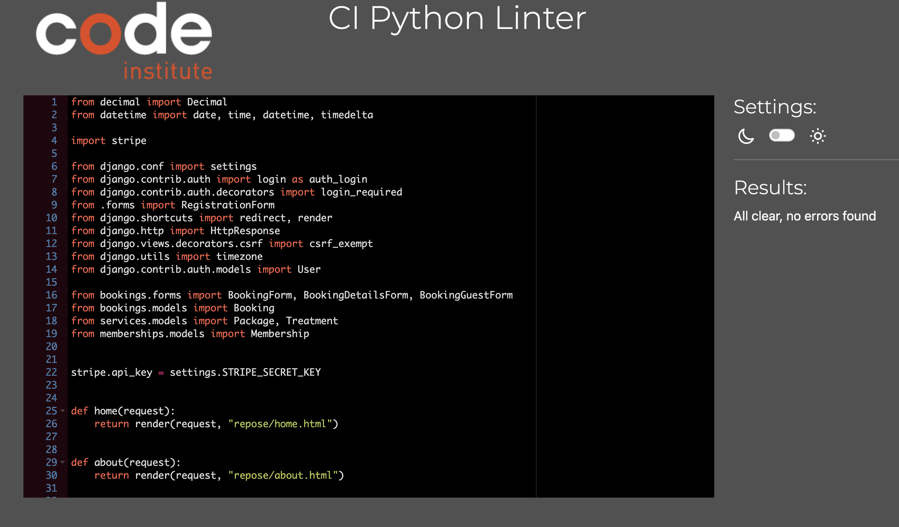
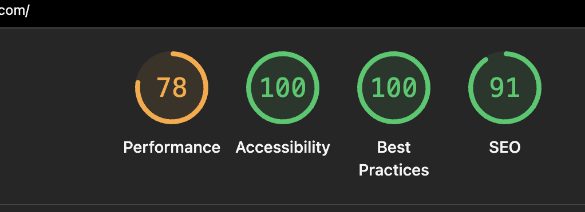
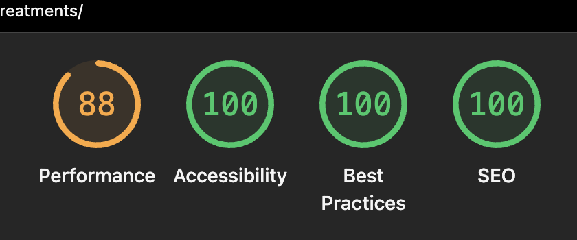
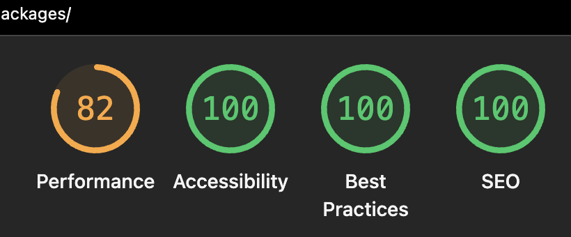
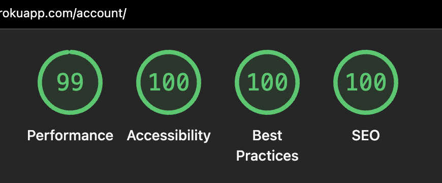

# Testing

Repose Spa & Wellness was tested throughout development to verify functionality, validation, responsiveness, accessibility and payment behaviour.

Testing was carried out both locally and on the deployed Heroku application. Particular attention was given to the multi-step booking process, membership functionality, authentication, Stripe Checkout and the administrative CRUD functionality provided through Django Admin.

The deployed website can be viewed here:

- [Repose Spa & Wellness Live Site](https://repose-cff44b1bb103.herokuapp.com/)

---

## Table of Contents

- [Manual Feature Testing](#manual-feature-testing)
- [CRUD Testing](#crud-testing)
- [Stripe Payment Testing](#stripe-payment-testing)
- [Responsive Design Testing](#responsive-design-testing)
- [Browser Compatibility](#browser-compatibility)
- [Accessibility Testing](#accessibility-testing)
- [Code Validation](#code-validation)
- [Lighthouse Testing](#lighthouse-testing)
- [Deployment Testing](#deployment-testing)

---

## Manual Feature Testing

The following manual tests cover the main user stories documented in README.md, including visitor navigation, authentication, bookings, membership benefits and administrative functionality.

### Public Navigation and Content

| Feature | Test | Expected Result | Actual Result | Status |
|---|---|---|---|---|
| Open Home page | Visit the deployed website | Hero content, navigation and feature cards are displayed | Worked as expected | Pass |
| Open About page | Select **About Us** | About content and hero section are displayed | Worked as expected | Pass |
| Open Treatments page | Select **Treatments** | Active treatments are displayed under the correct categories | Worked as expected | Pass |
| Open Packages page | Select **Packages** | Active packages and their inclusions are displayed | Worked as expected | Pass |
| Open Membership page | Select **Membership** | Membership price and benefits are displayed | Worked as expected | Pass |
| Open booking flow | Select **Book Now** | First booking step opens | Worked as expected | Pass |
| Navigate using feature cards | Select a Home page feature card | The corresponding page opens | Worked as expected | Pass |
| Invalid URL | Visit a URL that does not exist | Custom 404 page is displayed | Worked as expected on deployed site | Pass |
| Return from 404 page | Select **Return to Home** | User returns to the Home page | Worked as expected | Pass |

### Navigation

| Feature | Test | Expected Result | Actual Result | Status |
|---|---|---|---|---|
| Desktop navigation | View the site above the navigation breakpoint | Full navigation is displayed horizontally | Worked as expected | Pass |
| Mobile navigation | View the site below the navigation breakpoint | Hamburger button replaces desktop navigation | Worked as expected | Pass |
| Open hamburger menu | Select the hamburger button | Mobile navigation becomes visible | Worked as expected | Pass |
| Close hamburger menu | Select the button again | Menu closes and icon returns to hamburger state | Worked as expected | Pass |
| `aria-expanded` | Open and close mobile navigation | Value switches between `true` and `false` | Worked as expected | Pass |
| Logged-out navigation | Visit while logged out | Login and Register options are displayed | Worked as expected | Pass |
| Logged-in navigation | Log in successfully | My Account and Logout replace visitor account links | Worked as expected | Pass |

### Authentication

| Feature | Test | Expected Result | Actual Result | Status |
|---|---|---|---|---|
| Open Registration page | Select **Register** | Registration form opens | Worked as expected | Pass |
| Register valid account | Submit valid account details | Account is created successfully | Worked as expected | Pass |
| Duplicate email | Register using an email already connected to an account | Validation prevents duplicate email registration | Worked as expected | Pass |
| Required registration fields | Submit incomplete form | Validation feedback is displayed | Worked as expected | Pass |
| Password mismatch | Enter different passwords | Account is not created and validation feedback is shown | Worked as expected | Pass |
| Open Login page | Select **Login** | Login form opens | Worked as expected | Pass |
| Valid login | Submit correct username and password | User is authenticated | Worked as expected | Pass |
| Invalid login | Submit incorrect credentials | Login fails and validation feedback is displayed | Worked as expected | Pass |
| Logout | Select **Logout** | Authenticated session ends | Worked as expected | Pass |
| Membership registration redirect | Start membership purchase while logged out and register | User is returned to the membership process after registration | Worked as expected | Pass |

### Booking Flow

#### Booking Step One

| Test | Expected Result | Actual Result | Status |
|---|---|---|---|
| Open booking page | Spa Access, Treatment and Package options are available to eligible users | Worked as expected | Pass |
| Select Spa Access | No treatment or package selection is required | Worked as expected | Pass |
| Select Treatment | Treatment field becomes visible | Worked as expected | Pass |
| Select Package | Package field becomes visible | Worked as expected | Pass |
| Switch booking type | Irrelevant service field is hidden | Worked as expected | Pass |
| Continue with valid Spa Access selection | User continues to booking details | Worked as expected | Pass |
| Continue with valid Treatment selection | Selected treatment is stored and user continues | Worked as expected | Pass |
| Continue with valid Package selection | Selected package is stored and user continues | Worked as expected | Pass |
| Treatment without selecting treatment | Form prevents progression | Worked as expected | Pass |
| Package without selecting package | Form prevents progression | Worked as expected | Pass |
| Active member opens booking | Spa Access option is excluded because it is included in membership | Worked as expected | Pass |

#### Booking Details

| Test | Expected Result | Actual Result | Status |
|---|---|---|---|
| Select valid future date | Date is accepted | Worked as expected | Pass |
| Select past date | Submission is rejected | Worked as expected | Pass |
| Manually submit past date | Backend validation rejects the date | Worked as expected | Pass |
| Select valid time | Booking can continue | Worked as expected | Pass |
| Select invalid past same-day time | Backend validation rejects the time | Worked as expected | Pass |
| Spa Access booking | Valid spa time slots are displayed | Worked as expected | Pass |
| Treatment booking | Appropriate treatment time options are displayed | Worked as expected | Pass |
| Package booking | Time options reflect the selected package | Worked as expected | Pass |
| Standard guest selection | Valid guest quantities can be selected | Worked as expected | Pass |
| Repose for Two package | Only 2, 4 or 6 guests can be selected | Worked as expected | Pass |
| Full date input | Clicking the date field opens the browser date picker where supported | Worked as expected | Pass |

#### Guest Details

| Test | Expected Result | Actual Result | Status |
|---|---|---|---|
| Guest booking | User can enter required guest/contact information | Worked as expected | Pass |
| Logged-in booking | Existing account information is pre-filled where applicable | Worked as expected | Pass |
| Missing required information | Form submission is prevented | Worked as expected | Pass |
| Valid information | User continues to Booking Review | Worked as expected | Pass |

#### Booking Review

| Test | Expected Result | Actual Result | Status |
|---|---|---|---|
| Review booking | Correct service, date, time and guest quantity are displayed | Worked as expected | Pass |
| Spa Access price | Total reflects guest quantity | Worked as expected | Pass |
| Treatment price | Total reflects treatment price and guest quantity | Worked as expected | Pass |
| Package price | Correct package quantity is calculated from guest quantity | Worked as expected | Pass |
| Active member treatment | 15% discount is applied to eligible standalone treatment | Worked as expected | Pass |
| Member treatment guest quantity | Active member can only book one guest for discounted treatment | Worked as expected | Pass |
| Active member package | Package remains at full price | Worked as expected | Pass |
| Continue to payment | Stripe Checkout opens | Worked as expected | Pass |
| Cancel before payment | User can return without completing payment | Worked as expected | Pass |

### Membership Testing

| Feature | Test | Expected Result | Actual Result | Status |
|---|---|---|---|---|
| Membership information | Open Membership page | Price and membership benefits are displayed | Worked as expected | Pass |
| Logged-out membership purchase | Select membership purchase while logged out | User is directed to register/login | Worked as expected | Pass |
| Membership intent preserved | Register after selecting membership | User returns to membership process | Worked as expected | Pass |
| Start membership payment | Authenticated non-member selects membership purchase | Stripe Checkout opens with membership payment | Worked as expected | Pass |
| Successful membership payment | Complete Stripe Checkout | Membership becomes active for the authenticated account | Worked as expected | Pass |
| Membership record | View user in Django Admin | Membership start/end dates and active status are stored | Worked as expected | Pass |
| My Account membership | Open My Account as active member | Membership status and dates are displayed | Worked as expected | Pass |
| Membership page as active member | Revisit Membership page | Purchase CTA is replaced by account/membership link | Worked as expected | Pass |
| Member spa booking | Open booking as active member | Paid Spa Access option is unavailable | Worked as expected | Pass |
| Member treatment discount | Book standalone treatment | 15% discount is applied | Worked as expected | Pass |
| Member multi-guest treatment | Attempt to book multiple treatment guests | Booking is restricted to one guest | Worked as expected | Pass |
| Member package | Book a spa package | Package remains at standard price | Worked as expected | Pass |

### My Account

| Feature | Test | Expected Result | Actual Result | Status |
|---|---|---|---|---|
| Access while logged out | Attempt to access My Account | User is redirected to Login | Worked as expected | Pass |
| Access while logged in | Open My Account | Account page is displayed | Worked as expected | Pass |
| Upcoming bookings | Create a paid future booking | Booking appears in upcoming bookings | Worked as expected | Pass |
| Previous bookings | View a booking with a past date | Booking appears in previous bookings | Not tested | Not tested |
| Today's booking | View a confirmed booking dated today | Booking remains in Upcoming Bookings | Worked as designed | Pass |
| Membership status | Open as active member | Membership dates and status are displayed | Worked as expected | Pass |
| No membership | Open as non-member | Membership CTA is displayed | Worked as expected | Pass |

---

## CRUD Testing

Django Admin provides the administrative CRUD functionality for the application's relational data.

### Treatment CRUD

| Operation | Test | Expected Result | Status |
|---|---|---|---|
| Create | Add a new Treatment through Django Admin | New treatment is saved and can appear on the Treatments page when active | Pass |
| Read | Open the Treatment list/detail in Admin | Existing treatment information is displayed | Pass |
| Update | Change treatment details | Updated information is saved and reflected on the website | Pass |
| Delete | Delete a test treatment | Treatment record is removed | Not tested |

### Package CRUD

| Operation | Test | Expected Result | Status |
|---|---|---|---|
| Create | Add a new Package through Django Admin | New package is saved and can appear on the Packages page when active | Pass |
| Read | Open Package records | Existing package data is displayed | Pass |
| Update | Change package details or inclusions | Changes are saved and reflected on the website | Pass |
| Delete | Delete a test package | Package record is removed | Not tested |

### Booking CRUD

| Operation | Test | Expected Result | Status |
|---|---|---|---|
| Create | Create a booking through the customer booking flow | Booking record is created | Pass |
| Read | View booking through My Account/Admin | Booking data is displayed | Pass |
| Update | Update a booking record through Django Admin | Changes are saved | Not tested |
| Delete | Delete a test booking through Django Admin | Booking record is removed | Not tested |

### Membership CRUD

| Operation | Test | Expected Result | Status |
|---|---|---|---|
| Create | Complete a successful membership payment or create a test record in Admin | Membership record is created | Pass |
| Read | Open membership through My Account/Admin | Membership information is displayed | Pass |
| Update | Update test membership data through Admin | Changes are saved | Not tested |
| Delete | Delete a test membership record through Admin | Membership record is removed | Not tested |

Some additional CRUD test scenarios were identified but could not be completed before submission. These are marked as "Not tested" in the tables above.

---

## Stripe Payment Testing

Stripe is configured in **test mode**, so no real payments are processed.

### Successful Booking Payment

| Test | Expected Result | Actual Result | Status |
|---|---|---|---|
| Continue from Booking Review | Stripe Checkout Session opens | Worked as expected | Pass |
| Complete valid test payment | Stripe confirms successful payment | Worked as expected | Pass |
| Return to success page | Booking confirmation is displayed | Worked as expected | Pass |
| Check database | Booking changes from `pending` to `paid` | Worked as expected | Pass |
| Check My Account | Paid booking appears for authenticated user | Worked as expected | Pass |

  

### Declined Card Payment

Stripe Checkout handles declined payments directly on the hosted payment page.

| Test | Expected Result | Actual Result | Status |
|---|---|---|---|
| Submit Stripe test card that is declined | Stripe displays payment error without returning to Repose | Not tested | Not tested |
| Retry payment | User can enter another payment method without restarting booking | Not tested | Not tested |

### Cancelled Payment

| Test | Expected Result | Actual Result | Status |
|---|---|---|---|
| Select cancel/return from Stripe Checkout | User returns to Repose cancellation flow | Worked as expected | Pass |
| Check unfinished booking | Booking is not marked as successfully paid | Worked as expected | Pass |

  

### Expired Checkout Session

| Test | Expected Result | Actual Result | Status |
|---|---|---|---|
| Allow pending Checkout Session to expire | Stripe sends `checkout.session.expired` webhook | Verified during development | Pass |
| Check related booking | Pending booking becomes `cancelled` | Verified during development | Pass |
| Already-paid booking receives unrelated event | Paid status is not incorrectly overwritten | Not tested | Not tested |

### Stripe Webhook

| Test | Expected Result | Actual Result | Status |
|---|---|---|---|
| `checkout.session.completed` received | Related booking or membership is processed | Worked as expected | Pass |
| `checkout.session.expired` received | Pending booking is marked cancelled | Worked as expected | Pass |
| Valid webhook signature | Event is accepted | Worked as expected | Pass |
| Invalid webhook signature | Request is rejected | Not tested | Not tested |

### Membership Payment

| Test | Expected Result | Actual Result | Status |
|---|---|---|---|
| Start membership Checkout | £999 membership Checkout opens | Worked as expected | Pass |
| Complete valid test payment | Stripe reports successful payment | Worked as expected | Pass |
| Return to Repose | Success confirmation is displayed | Worked as expected | Pass |
| Check Membership record | Membership is linked to correct authenticated user | Worked as expected | Pass |
| Check membership validity | Start and end dates are stored | Worked as expected | Pass |

  

---

## Responsive Design Testing

Repose was developed using a mobile-first approach and tested using Chrome Developer Tools / Inspector at multiple viewport widths. Testing focuses on navigation, image scaling, service cards, forms, buttons and avoiding horizontal scrolling.

| Width | Device category | Expected behaviour | Status |
|---:|---|---|---|
| 320px | Small mobile | Content fits without unwanted horizontal scrolling | Not tested |
| 375px | Mobile | Hamburger navigation, cards and forms remain usable | Not tested |
| 768px | Tablet | Cards, typography and spacing adapt correctly | Not tested |
| 1024px | Tablet / small desktop | Navigation and grid layouts remain usable | Not tested |
| 1440px | Desktop | Full navigation and content remain centred and readable | Not tested |

The individual viewport test cases above have not been documented as completed. Responsive design was considered throughout development, but these specific checks remain outstanding.

---

## Browser Compatibility

The following browser-specific test cases were identified but have not been documented as completed.

| Browser | Device / Operating System | Result |
|---|---|---|
| Google Chrome | macOS | Not tested |
| Safari | macOS | Not tested |

The planned browser compatibility checks include:

- Navigation and hamburger behaviour.
- Images and hero sections.
- Forms and date inputs.
- Booking flow.
- Stripe Checkout redirect.
- Login and registration.
- My Account.
- Responsive layout.

---

## Accessibility Testing

Accessibility was considered throughout development and reviewed as part of Lighthouse testing. The following table also identifies additional manual checks.

| Test | Expected Result | Status |
|---|---|---|
| Semantic HTML | Appropriate structural elements and headings are used | Not tested |
| Keyboard navigation | Interactive controls can be reached using Tab | Not tested |
| Visible focus | Focus state is clearly visible on interactive controls | Not tested |
| Form labels | Form inputs have appropriate labels | Not tested |
| Navigation toggle | Hamburger has accessible label and state information | Not tested |
| `aria-expanded` | State changes when mobile navigation opens/closes | Pass |
| `aria-controls` | Toggle references the mobile navigation element correctly | Not tested |
| Image alternatives | Meaningful images include appropriate `alt` text | Not tested |
| Decorative images | Decorative assets do not receive unnecessary descriptive text | Not tested |
| Colour contrast | Text and controls remain readable against backgrounds | Not tested |
| Zoom | Page remains usable at increased browser zoom | Not tested |
| Reduced motion | Hero animation respects `prefers-reduced-motion` | Not tested |
| Custom 404 | Error page provides a clear route back to the website | Pass |

The Lighthouse accessibility results are documented separately below. Manual test cases not independently verified are marked as "Not tested".

---

## Code Validation

### HTML Validation

All rendered HTML pages were validated using the [W3C Nu HTML Checker](https://validator.w3.org/nu/). Identified structural warnings were addressed and the pages were revalidated.

Django templates were validated using their rendered HTML rather than raw template files.

| Page | Result | Validation |
|---|---|---|
| Home | Pass | [W3C Validator](https://validator.w3.org/nu/?doc=https%3A%2F%2Frepose-cff44b1bb103.herokuapp.com%2F) |
| About | Pass | [W3C Validator](https://validator.w3.org/nu/?doc=https%3A%2F%2Frepose-cff44b1bb103.herokuapp.com%2Fabout%2F) |
| Treatments | Pass | [W3C Validator](https://validator.w3.org/nu/?doc=https%3A%2F%2Frepose-cff44b1bb103.herokuapp.com%2Ftreatments%2F) |
| Packages | Pass | [W3C Validator](https://validator.w3.org/nu/?doc=https%3A%2F%2Frepose-cff44b1bb103.herokuapp.com%2Fpackages%2F) |
| Membership | Pass | [W3C Validator](https://validator.w3.org/nu/?doc=https%3A%2F%2Frepose-cff44b1bb103.herokuapp.com%2Fmembership%2F) |
| Booking | Pass | [W3C Validator](https://validator.w3.org/nu/?doc=https%3A%2F%2Frepose-cff44b1bb103.herokuapp.com%2Fbook%2F) |
| Booking Details | Pass | [W3C Validator](https://validator.w3.org/nu/?doc=https%3A%2F%2Frepose-cff44b1bb103.herokuapp.com%2Fbook%2Fdetails%2F) |
| Guest Details | Pass | [W3C Validator](https://validator.w3.org/nu/?doc=https%3A%2F%2Frepose-cff44b1bb103.herokuapp.com%2Fbook%2Fguest%2F) |
| Booking Review | Pass | [W3C Validator](https://validator.w3.org/nu/?doc=https%3A%2F%2Frepose-cff44b1bb103.herokuapp.com%2Fbook%2Freview%2F) |
| Registration | Pass | [W3C Validator](https://validator.w3.org/nu/?doc=https%3A%2F%2Frepose-cff44b1bb103.herokuapp.com%2Fregister%2F) |
| Login | Pass | [W3C Validator](https://validator.w3.org/nu/?doc=https%3A%2F%2Frepose-cff44b1bb103.herokuapp.com%2Flogin%2F) |
| My Account | Pass | [W3C Validator](https://validator.w3.org/nu/?doc=https%3A%2F%2Frepose-cff44b1bb103.herokuapp.com%2Faccount%2F) |
| Custom 404 | Pass | Validated using rendered HTML via text input, as the page correctly returns HTTP 404. |

**Note:** The custom 404 page could not be validated directly by URL because the server correctly returned an HTTP 404 status. Instead, its rendered HTML was submitted manually using the validator's text input option.

### CSS Validation

The deployed pages were tested using the [W3C CSS Validation Service](https://jigsaw.w3.org/css-validator/).

All tested pages passed CSS validation successfully.

| Page | Result | Validation |
|---|---|---|
| Home | Pass | [View result](https://jigsaw.w3.org/css-validator/validator?uri=https%3A%2F%2Frepose-cff44b1bb103.herokuapp.com%2F&profile=css3svg&usermedium=all&warning=1&vextwarning=&lang=sv) |
| About | Pass | [View result](https://jigsaw.w3.org/css-validator/validator?uri=https%3A%2F%2Frepose-cff44b1bb103.herokuapp.com%2Fabout%2F&profile=css3svg&usermedium=all&warning=1&vextwarning=&lang=sv) |
| Treatments | Pass | [View result](https://jigsaw.w3.org/css-validator/validator?uri=https%3A%2F%2Frepose-cff44b1bb103.herokuapp.com%2Ftreatments%2F&profile=css3svg&usermedium=all&warning=1&vextwarning=&lang=sv) |
| Packages | Pass | [View result](https://jigsaw.w3.org/css-validator/validator?uri=https%3A%2F%2Frepose-cff44b1bb103.herokuapp.com%2Fpackages%2F&profile=css3svg&usermedium=all&warning=1&vextwarning=&lang=sv) |
| Membership | Pass | [View result](https://jigsaw.w3.org/css-validator/validator?uri=https%3A%2F%2Frepose-cff44b1bb103.herokuapp.com%2Fmembership%2F&profile=css3svg&usermedium=all&warning=1&vextwarning=&lang=sv) |
| My Account | Pass | [View result](https://jigsaw.w3.org/css-validator/validator?uri=https%3A%2F%2Frepose-cff44b1bb103.herokuapp.com%2Faccount%2F&profile=css3svg&usermedium=all&warning=1&vextwarning=&lang=sv) |
| Book | Pass | [View result](https://jigsaw.w3.org/css-validator/validator?uri=https%3A%2F%2Frepose-cff44b1bb103.herokuapp.com%2Fbook%2F&profile=css3svg&usermedium=all&warning=1&vextwarning=&lang=sv) |
| Booking Details | Pass | [View result](https://jigsaw.w3.org/css-validator/validator?uri=https%3A%2F%2Frepose-cff44b1bb103.herokuapp.com%2Fbook%2Fdetails%2F&profile=css3svg&usermedium=all&warning=1&vextwarning=&lang=sv) |
| Guest Details | Pass | [View result](https://jigsaw.w3.org/css-validator/validator?uri=https%3A%2F%2Frepose-cff44b1bb103.herokuapp.com%2Fbook%2Fguest%2F&profile=css3svg&usermedium=all&warning=1&vextwarning=&lang=sv) |
| Booking Review | Pass | [View result](https://jigsaw.w3.org/css-validator/validator?uri=https%3A%2F%2Frepose-cff44b1bb103.herokuapp.com%2Fbook%2Freview%2F&profile=css3svg&usermedium=all&warning=1&vextwarning=&lang=sv) |
| Login | Pass | [View result](https://jigsaw.w3.org/css-validator/validator?uri=https%3A%2F%2Frepose-cff44b1bb103.herokuapp.com%2Flogin%2F&profile=css3svg&usermedium=all&warning=1&vextwarning=&lang=sv) |
| Register | Pass | [View result](https://jigsaw.w3.org/css-validator/validator?uri=https%3A%2F%2Frepose-cff44b1bb103.herokuapp.com%2Fregister%2F&profile=css3svg&usermedium=all&warning=1&vextwarning=&lang=sv) |

### JavaScript Validation

JavaScript files were validated using [JSHint](https://jshint.com/) with ES6 enabled.

| File / Functionality | Result |
|---|---|
| Hamburger navigation | Pass – No warnings with ES6 enabled in JSHint. |
| Booking form interaction | Pass – No warnings with ES6 enabled in JSHint. |

### Python Validation

Python files were validated using the [CI Python Linter](https://pep8ci.herokuapp.com/) to check compliance with PEP 8 coding standards. Minor spacing issues were corrected during validation.

| File | Result |
|---|---|
| `repose/views.py` | Pass |
| `repose/forms.py` | Pass |
| `repose/urls.py` | Pass |
| `bookings/models.py` | Pass |
| `bookings/forms.py` | Pass |
| `services/models.py` | Pass |

The following screenshots show examples of the Python validation results.

  

  

---

## Lighthouse Testing

Lighthouse testing was performed on the deployed Heroku application using Google Chrome Developer Tools.

The following categories were evaluated:

- Performance
- Accessibility
- Best Practices
- SEO

### Lighthouse Results

| Page | Performance | Accessibility | Best Practices | SEO |
|---|---:|---:|---:|---:|
| Home | 78 | 100 | 100 | 91 |
| Treatments | 88 | 100 | 100 | 100 |
| Packages | 82 | 100 | 100 | 100 |
| My Account | 99 | 100 | 100 | 100 |
| Booking | 98 | 100 | 100 | 100 |

### Test Observations

- Performance scores varied between Lighthouse runs, particularly on pages containing large hero images. Tests were conducted in both regular Chrome browsing sessions and Incognito mode, where performance results were sometimes higher.
- These variations may be influenced by factors such as network conditions, server response times, browser extensions, caching and image loading.
- Pages with fewer large images, such as Booking and My Account, consistently achieved higher performance scores during testing.
- Image loading was improved during development by introducing lazy loading for below-the-fold images and prioritising the loading of hero images.
- Further optimisation of image file sizes and formats, such as converting large images to WebP, has been identified as a potential future improvement.

### Lighthouse Evidence

**Home**

  

**Treatments**

  

**Packages**

  

**My Account**

  

**Booking**

  

---

## Deployment Testing

The deployed Heroku version was tested separately from the local development environment.

| Test | Expected Result | Actual Result | Status |
|---|---|---|---|
| Open deployed Home page | Website loads successfully | Worked as expected | Pass |
| Static CSS | Styles load with `DEBUG=False` | Worked as expected | Pass |
| Static images | Images load correctly | Worked as expected | Pass |
| Custom 404 | Invalid URL displays styled custom error page | Worked as expected | Pass |
| PostgreSQL data | Treatments and packages load from production database | Worked as expected | Pass |
| Django Admin | Admin dashboard and model lists load successfully | Worked as expected after runtime fix | Pass |
| Registration/Login | Authentication works in production | Worked as expected | Pass |
| Booking flow | Booking can be completed on deployed site | Worked as expected | Pass |
| Stripe Checkout | Deployed site redirects to Stripe test Checkout | Worked as expected | Pass |
| Stripe webhook | Production webhook receives and processes successful payment | Worked as expected | Pass |
| Membership purchase | Membership can be purchased in Stripe test mode | Worked as expected | Pass |
| My Account | Paid booking and membership information display correctly | Worked as expected | Pass |

### Deployment Issue Resolved During Testing

During initial deployment, Heroku selected Python 3.14.8. The application itself loaded, but some Django Admin model-list pages returned a server error.

A `.python-version` file was added to the project root specifying Python 3.12. After redeployment, the Django Admin interface worked correctly.

---
